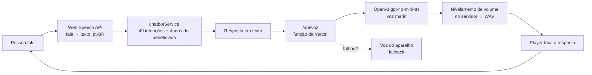

# Jornada

Plataforma de cuidado de saúde hiper-personalizado para beneficiários de plano de saúde. Projeto do squad para o **Challenge FIAP 2026**, em parceria com a **Unimed Nacional**.

**Demo:** [jornada-zapater.vercel.app](https://jornada-zapater.vercel.app) · **Acesso de demonstração:** `ana.souza@email.com` / `jornada123`


> **Escopo desta versão:** frontend web (React + Vite + Tailwind) com **dados simulados** e sem banco. A camada `src/services/` imita uma API REST (latência, erros HTTP, sessão JWT) para que a troca por um backend real mexa apenas nesses arquivos. A única peça de servidor é a função da Vercel `api/voz.js`, que gera a voz natural do assistente e mantém a chave da OpenAI fora do navegador.

---

## Inteligência Artificial no Jornada

O Jornada usa IA onde ela melhora o acesso: **conversar por voz com o assistente**, **ditar em vez de digitar** e **traduzir o conteúdo para Libras**. Onde a decisão envolve saúde, a escolha foi deliberada: **regras explicáveis em vez de modelo opaco**.

### Mapa rápido: o que é IA e o que não é

| Recurso | Usa IA? | Tecnologia | Onde está |
|---|---|---|---|
| **Voz natural** do assistente | Sim, síntese de fala por IA | OpenAI `gpt-4o-mini-tts` (voz `marin`, pt-BR) | `api/voz.js`, `useVozNatural` |
| **Ditado por voz** (fala → texto) | Sim, reconhecimento de fala | Web Speech API do navegador (pt-BR) | `useReconhecimentoDeFala` |
| **Conversa por voz** (ouve, responde falando e volta a ouvir) | Sim, combina os dois acima | Web Speech API + OpenAI TTS | `ConversaContext`, `useConversaPorVoz`, `PainelConversa` |
| **Modo Libras** | Sim, tradução e avatar do serviço do governo | VLibras (Governo Federal) | `ModoLibras.jsx` |
| **Assistente (chatbot)** | **Não, e é proposital** | Palavras-chave com 49 intenções | `src/services/chatbotService.js` |
| **Score de risco clínico (V1)** | **Não** | Soma de pontos por regras fixas | `src/services/riscoService.js` |

> **Por que o chatbot não usa LLM?** Um modelo generativo pode inventar uma regra de plano, uma cobertura ou uma orientação clínica. Em saúde, isso é risco real. O assistente do Jornada responde com **os dados reais do beneficiário** (próxima consulta, preparo de exame, mensalidade, unidade mais próxima), **recusa pergunta clínica**, **encaminha emergência para o SAMU 192** e, quando a resposta depende do contrato (carência, reembolso, cobertura), **diz que não sabe** e oferece um atendente. A IA entra na **interface** (voz), não na **decisão**.

### Como a conversa por voz funciona



O ciclo automático tem freios para não virar uma gravação sem fim:

- o microfone só liga depois de um toque e só abre quando a voz do assistente termina (para não transcrever a si mesmo);
- silêncio **pausa** a conversa em vez de religar o microfone sem parar;
- trocar de aba desliga tudo, e dizer "tchau" encerra.

### Voz natural: detalhes de engenharia

- **Modelo:** `gpt-4o-mini-tts`, voz `marin`, com instrução de falar em português do Brasil, em tom acolhedor.
- **Chave protegida:** `OPENAI_API_KEY` existe só como variável de ambiente na Vercel. O navegador chama `/api/voz` e nunca vê a chave.
- **Barreiras da função:** só `POST`, só da mesma origem, texto de 1 a 1.000 caracteres, 150 pedidos por IP a cada 5 minutos, `Cache-Control: no-store`. Nem o texto nem o erro da OpenAI vão para o log ou para a resposta.
- **Volume:** a voz sai baixa e o Safari do iPhone não deixa passar do volume 1 do `<audio>`. O nivelamento é feito **no servidor**: ganho até -10 dBFS de média e limitador com 5 ms de antecipação segurando os picos em -1 dBFS. Medido nas mesmas respostas: +10 dB na mediana.
- **Latência:** a resposta é dividida em blocos (primeira frase sozinha, o resto em blocos de até ~260 caracteres) e todos os pedidos saem ao mesmo tempo, então a primeira frase toca enquanto as outras chegam. Ao abrir a conversa, um pedido vazio "acorda" a função da Vercel.
- **Celular:** o navegador só libera áudio iniciado num toque. Por isso o app toca um silêncio no mesmo player, dentro do toque na bolinha (`destravar()`), e o painel informa o motivo se a voz não tocar.
- **Fallback:** sem chave, sem rede ou com limite estourado, a rota responde erro e o app cai para a voz do aparelho, sem quebrar a conversa.

### Privacidade e limites da IA

- O **texto das respostas** (que pode citar consulta, alergia ou mensalidade) é enviado à OpenAI para virar áudio. O painel e Configurações avisam isso, e a **Voz natural pode ser desligada**.
- O **ditado** usa a Web Speech API, que na maioria dos navegadores **envia o áudio ao serviço de voz do fabricante**. A tela avisa. O Firefox não implementa a API, e o botão nem aparece.
- No **modo Libras**, o texto enviado para tradução vai para o servidor do VLibras. O widget é **desligado por padrão** e conferido por SRI (hash sha256) da release 7.12.2.
- **Limite de gasto obrigatório:** sem login no servidor, alguém determinado ainda consegue chamar `/api/voz` fora do app. Defina um **limite de uso mensal** no projeto da OpenAI, que é a proteção real contra custo.
- O assistente **nunca diz se um resultado está "normal"** e não orienta sobre remédio ou sintoma. Redireciona para consulta.
- Dados sensíveis seguem a LGPD (art. 11 e 18), com trilha de auditoria e direito de exclusão no app.

### Testando o assistente

```bash
cd frontend
npm run test:assistente
```

Roda as **100 perguntas do roteiro de treinamento** (27 intenções) mais 20 perguntas dos módulos do app, e **falha se alguma cair na intenção errada**.

### Evolução prevista

- O backend Java (Spring Boot, pasta `backend/`) assume as regras hoje simuladas no navegador, com rate limit por IP e auditoria em banco.
- O score de risco pode evoluir para um modelo de ML trocando apenas `calcularScore()`; o histórico em `scoresRisco` permite comparar versões. Hoje **não é IA e não é diagnóstico**: a tela mostra cada fator e quantos pontos ele somou.

<!-- Se quiser, adicione aqui uma seção "IA no desenvolvimento" descrevendo como ferramentas de IA foram usadas para construir o projeto (por exemplo, assistente de código, geração de testes, revisão). -->

---

## Funcionalidades

Mantenha aqui a tabela de funcionalidades do README atual.

## Como rodar

```bash
cd frontend
npm install
npm run dev
```

Abra [http://localhost:5173](http://localhost:5173).

Para testar a voz natural localmente, use `vercel dev` com `OPENAI_API_KEY` num `.env.local` (modelo em `.env.example`). O `npm run dev` comum não roda a função e cai na voz do aparelho.

## Organização do repositório

Monorepo:

- `frontend/`: aplicação web React + Vite;
- `backend/`: espaço reservado para a futura API Java com Spring Boot;
- `docs/`: documentos de apoio, decisões e materiais do projeto.

Na Vercel, o **Root Directory** deve permanecer como `frontend`.

## Squad

Enzo de Lucca Borba Pires · Felipe Silva de Carvalho · Arthur Zapater · Gabriel Morais

---

*O restante do README atual (Estrutura, Deploy, Trocando o mock por uma API real, Segurança e privacidade, Diferenciais e Limites honestos) permanece como está, abaixo desta seção.*
